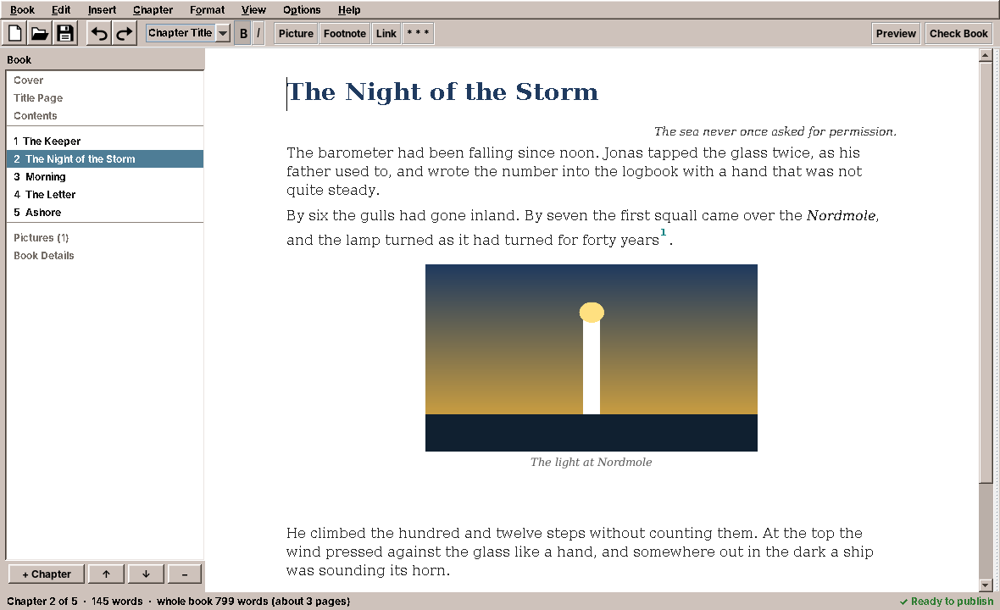

# amade-bookeditor

**Book Editor** is the e-book editor of the [amadeOS](https://github.com/amadeos-eu/amadeos) desktop: you write chapters in a window that works like a word processor, choose a look for the book, and save a valid, accessible **EPUB 3** that every e-reader and reading app can open. No HTML, no CSS, no files to keep together: the `.epub` is the document.




## Features

- **New Book** (Ctrl+N): title, author, language and one of four **looks** (*Classic*, *Modern*, *Children's Book*, *Poetry*), starting with an empty chapter or **from a text file**: `.txt` is split at lines such as "Chapter 3" or "Kapitel IV", `.md` at `#` headings, with emphasis, links, footnotes (`[^1]`), quotations, code and the pictures next to the file.
- **The outline** on the left: cover, title page, dedication, contents, the chapters, the pictures and the book details. Chapters are added (Ctrl+Enter), moved (Ctrl+Shift+Up/Down), split at the cursor, joined with the next one and deleted; a chapter can be left uncounted (a prologue).
- **Writing**: paragraph styles *Text* (Ctrl+0), *Chapter Title* (Ctrl+1), *Heading* (Ctrl+2), *Subheading* (Ctrl+3), *Quotation*, *Epigraph*, *Poem*, *Letter*, *Code* and *Centred*; bold, italic, superscript and subscript; **footnotes** (Ctrl+Alt+F), **links** to other chapters or web pages (Ctrl+K), **scene breaks** and **pictures** with a description for blind readers, a caption and a size. Double-click a picture or footnote to change it. Special characters with Ctrl+Shift+U.
- **Cover, title page and contents** are made from the book details; *Make a Cover* draws a simple cover (1600 × 2400) from title, author, colour and an optional picture.
- **Book Details** (Alt+Enter): title, subtitle, people with their roles, language, series, publisher, date, ISBN (checked), keywords, description, licence (Creative Commons or all rights reserved) and an accessibility summary.
- **Preview** (F8): the chapter set into pages by the same typesetter as amadeOS Books, on a phone, a tablet or an e-reader, in day, sepia or night colours.
- **Check Book** (F7) says in plain words what is missing or wrong, each with a button that leads there, and then runs [EPUBCheck](https://www.w3.org/publishing/epubcheck/) when the `epubcheck` package is installed. With *Check While Writing* the status line shows whether the book is ready.
- **Saving**: *Save* (Ctrl+S) writes the `.epub` (through a temporary file, so a crash never leaves half a book); **every two minutes automatically** once the book has a file; the last ten versions of every book stay in `~/.cache/amadeos/book-editor/backups/`.
- Five languages (English, Deutsch, Français, Español, Italiano), following the desktop language; *Options → Language* overrides it.

This version opens only books it saved itself (it marks them in the package document). Other EPUBs open in Books; editing them and importing word-processor documents is planned.

## What the EPUB contains

`EPUB/package.opf` with Dublin Core and schema.org accessibility metadata, `nav.xhtml` (contents and landmarks), `toc.ncx` for older readers, one XHTML file per chapter, the cover and title pages, `styles/book.css` (the look) and the pictures. Every book the tests save passes EPUBCheck 5 without errors or warnings.

## Architecture

Java 25, Swing and Guice; start-up, theme and language come from `AmadeApplication` in [amade-commons](https://github.com/amadeos-eu/amade-commons), the preview's typesetter from its `typeset` package.

| Package | Contents |
|---|---|
| `bootstrap` | `AmadeBookEditorApplication`, `BookEditorModule` |
| `domain.book` | `Book`, `BookInfo`, `Chapter`, `Block` (paragraph, picture, scene break), `Inline` (text, footnote), `ParaStyle`, `Look`, `Resource`, `License`, `Person`, `Role` |
| `domain.epub` | `EpubWriter`, `EpubReader`, `ChapterWriter`, `BookTexts` (the words the book itself contains, per language) |
| `domain.importer` | `TextImport` (plain text and Markdown) |
| `domain.check` | `BookCheck`, `Finding`, `EpubCheckRunner` |
| `domain.cover` | `CoverDesign`, `CoverMaker`, `Pictures` |
| `repository` | `EditorPreferences`, `Backups` |
| `ui.editor` | `ChapterEditor` (a `JTextPane`), `ChapterDocument` (chapter ⇄ styled document), the icons for pictures, footnotes and scene breaks |
| `ui.dialogs` | New Book, Book Details, Make a Cover, Picture, Link, Footnote, Check Book |
| `ui.main` | `MainWindow`, `OutlinePanel`, `Pages`, `PreviewPanel`, `Ask` (the questions the window asks, replaced in the tests) |

## Build and run

```sh
./gradlew run                              # start
xvfb-run ./gradlew test                    # the window tests need a display
xvfb-run ./gradlew screenshots             # the pictures in docs/screenshots
./gradlew deb                              # build/distributions/amade-bookeditor_<version>_all.deb
./gradlew installToAmadeOs                 # the .deb into ../amadeos/config/packages.chroot/ for the ISO build
```

If `../amade-commons` is checked out next to this repository, Gradle builds against that checkout instead of the JitPack version.

## Planned

- Opening and editing EPUBs from other programs
- Importing ODT and DOCX documents
- Tables, lists and fonts of your own
- Exporting as PDF for print

## License

[EUPL-1.2](LICENSE)
